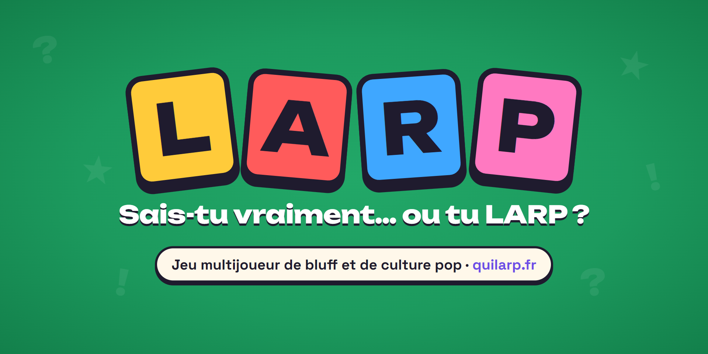
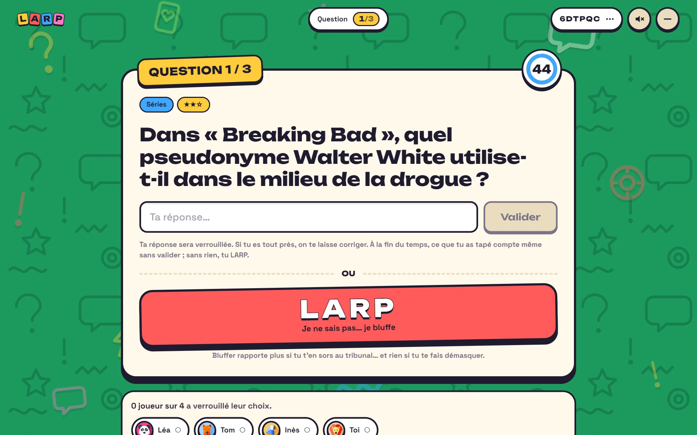
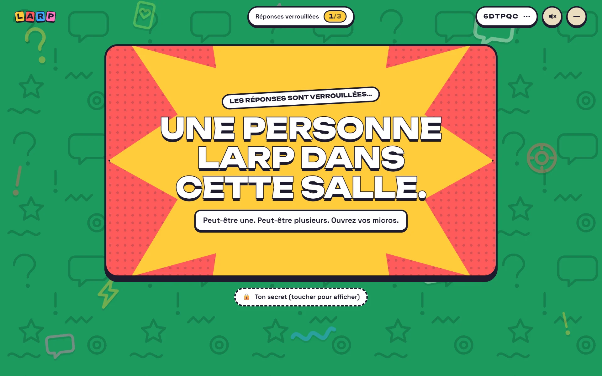
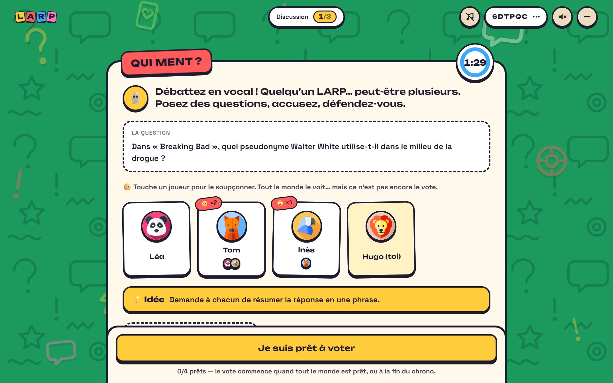
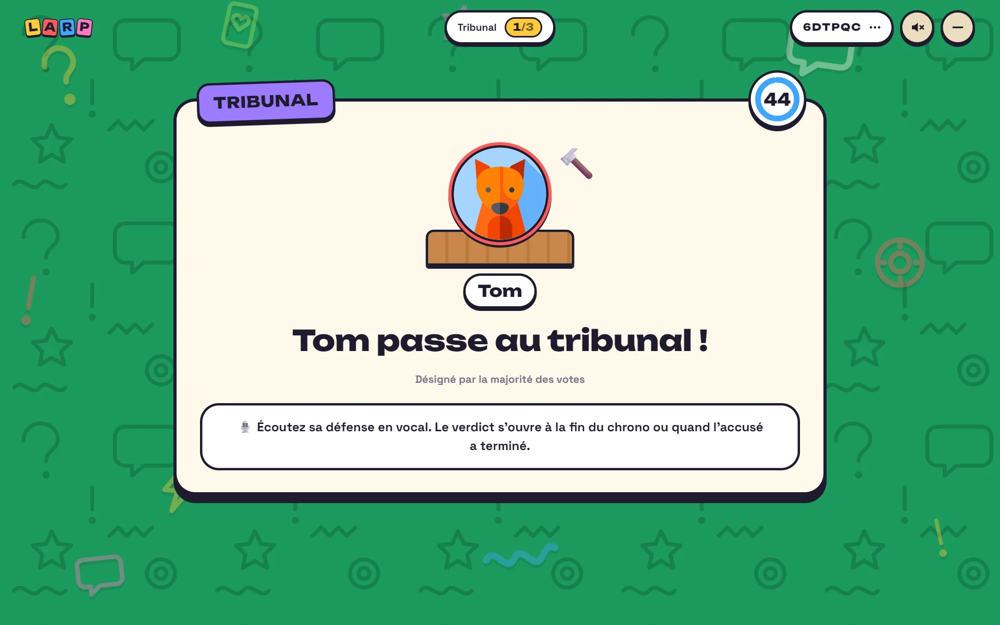
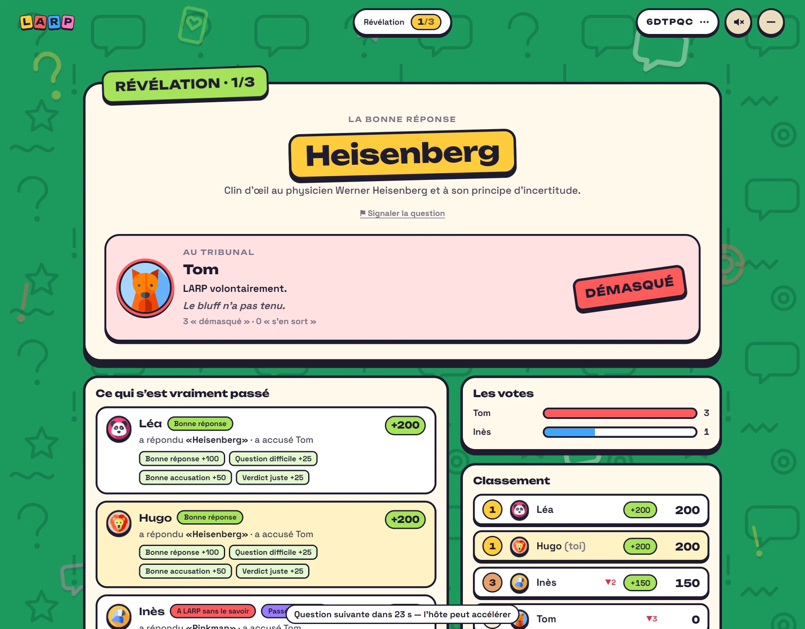
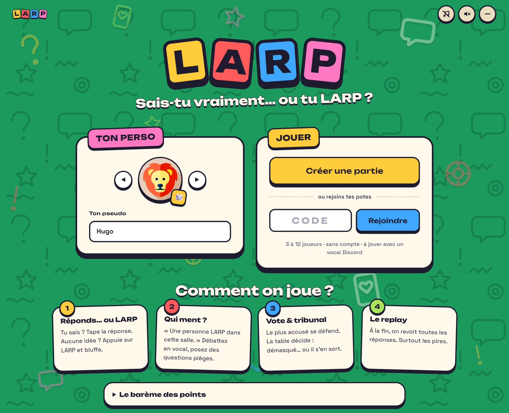
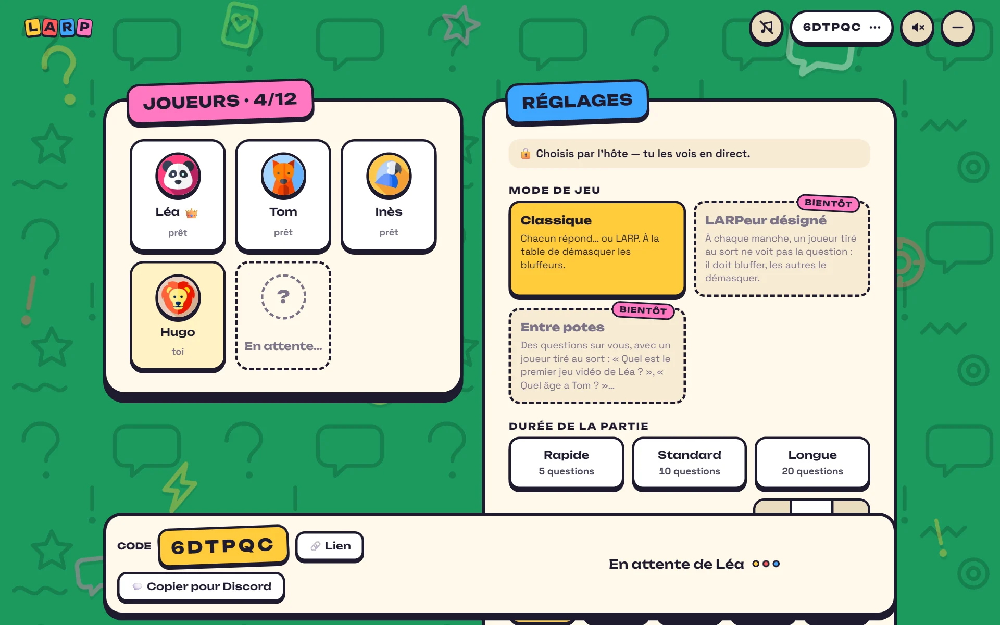
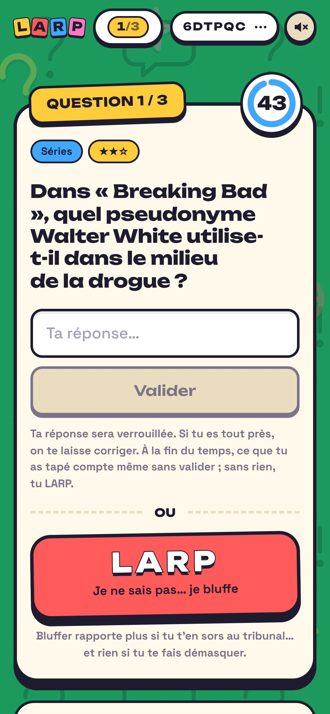

  

  <a href="https://quilarp.fr"><b>▶ Jouer sur quilarp.fr</b></a> 
  gratuit · sans compte · 3 à 12 joueurs · ordinateur et téléphone

**LARP** est un jeu multijoueur de bluff et de culture pop, à jouer entre potes avec un vocal Discord ou autour d'une table. À chaque question, tu réponds… ou tu bluffes. Ensuite, toute la table doit démasquer ceux qui font semblant de savoir.

> Le mot vient du jeu de rôle grandeur nature : quelqu'un qui « LARP » joue un rôle. Ici, il fait semblant de connaître la réponse.

## Comment on joue

### 1. Réponds… ou LARP

Une question de culture pop s'affiche : films, séries, animés, jeux vidéo, musique… Chacun répond en secret. Tu ne sais pas ? Appuie sur **LARP** et bluffe. Une mauvaise réponse fait aussi de toi un LARP, sans que personne ne le sache.

### 2. « Une personne LARP dans cette salle »

Le jeu annonce qu'il y a un bluffeur… sans dire combien, ni qui.

### 3. Qui ment ?

Le débat se passe en vocal. Chacun résume « sa » réponse, on pose des questions pièges et on soupçonne en direct : tout le monde voit qui accuse qui.

### 4. Vote et tribunal

Le plus accusé passe au tribunal. Il se défend, puis la table rend son verdict : démasqué… ou il s'en sort.

### 5. La révélation

La bonne réponse, la vérité sur chacun et les points. Bluffer rapporte gros si personne ne te démasque ; accuser à tort coûte cher.

À la fin de la partie, un **replay** façon album rejoue toutes les réponses (les pires finissent au bêtisier), puis la **cérémonie** révèle le podium et les distinctions : le roi du LARP, le détective, le bouc émissaire…

## Ce qu'il y a dedans

- **1 599 questions, dont 923 blind tests**, dans 8 catégories : Musique, Films, Séries, Dessins animés, Animés & mangas, Jeux vidéo, Personnages, Culture générale.
- **Musique en quatre sous-catégories** : Musique du monde, Populaire français, Rap FR ★★★★ (pour les vrais connaisseurs) et YouTubeurs français. À chaque manche, le jeu demande au hasard l'artiste ou le titre.
- **Blind tests** : un extrait de 5 secondes tiré au hasard dans le morceau, jamais le même d'une partie à l'autre. Openings d'animés, musiques de films, génériques de séries et de dessins animés, musiques de jeux vidéo.
- **Images floutées** qui se précisent pendant le temps de réponse, et **rébus émoji**.
- **Mode « Que du blind test »** et **cinq niveaux** : Mélangé, Facile ★, Moyen ★★, Expert ★★★, Légende ★★★★. La difficulté de chaque question s'ajuste toute seule d'après les bonnes réponses en partie.
- **Course de vitesse** : quand tout le monde a trouvé, les plus rapides prennent un bonus.
- **« Tu n'es plus très loin »** : une faute de frappe ou un mot manquant ne te transforme pas en LARP, tu peux corriger.
- **Connexion Discord facultative** pour garder ton pseudo et ton avatar.
- **Bientôt** : les modes « LARPeur désigné » et « Entre potes ».

## En images

<table>
  <tr>
    <td width="50%"></td>
    <td width="50%"></td>
  </tr>
  <tr>
    <td align="center">L'accueil : choisis ton perso, crée une partie ou rejoins tes potes.</td>
    <td align="center">Le salon : l'hôte règle la partie, tout le monde voit les réglages en direct.</td>
  </tr>
</table>

   
  Pensé pour le téléphone : on joue d'une main, le vocal dans l'autre.

## Sous le capot

Le code source est privé, mais voici comment le jeu est construit.

- **TypeScript de bout en bout**, en monorepo : `shared` (types et règles communes), `server` et `client`.
- **Client** : React 19, Vite et CSS Modules. Pensé d'abord pour le téléphone, avec des bruitages d'interface et des animations qui respectent le réglage « réduire les animations ».
- **Serveur** : Node.js 22, Express 5 et Socket.IO. Chaque message est validé (Zod) ; les données vivent dans SQLite (`node:sqlite`), avec des migrations versionnées.
- **Le serveur fait autorité.** Une machine à états mène la partie (question, annonce, débat, vote, tribunal, révélation). Le navigateur n'affiche que ce que le serveur lui envoie : les réponses et le statut secret de chacun ne quittent jamais le serveur.
- **Médias protégés contre la triche.** Pour un blind test, le serveur découpe un passage de 5 secondes dans le MP3 et le sert sous une adresse aléatoire et éphémère. Pour une image floutée, chaque palier de flou n'arrive qu'au moment voulu. Impossible d'écouter le morceau en entier ou de récupérer l'image nette avant l'heure.
- **Correction des réponses** : accents, articles et ponctuation normalisés, alias acceptés, tolérance encadrée aux fautes de frappe, et indices « presque juste » ou « réponse incomplète ».
- **Difficulté auto-calibrée** à partir des résultats réels des parties.
- **Préparation des médias** avec ffmpeg : silences retirés, volume égalisé, MP3 à débit constant (découpable au vol), images en WebP avec leurs paliers de flou.
- **Tests** : une centaine de tests automatisés (Vitest), dont des parties complètes jouées par de vrais clients Socket.IO.
- **Hébergement** : un serveur privé virtuel, HTTPS automatique avec Caddy, service systemd ; les mises à jour ne touchent jamais aux parties déjà jouées.

## Une idée, un bug, le code ?

Le dépôt du jeu est privé. Tu es développeur et le projet t'intéresse, tu as une idée de question ou de mode de jeu, ou tu as repéré un bug ? Ouvre une [issue](../../issues) sur ce dépôt.

## Crédits

Imaginé et réalisé par **[War3l](https://github.com/War3l)** (idée et direction artistique), avec l'aide d'une intelligence artificielle pour le développement.

LARP est un **projet de fans, gratuit et non commercial**. Les extraits musicaux, les images et les noms d'œuvres cités dans les questions appartiennent à leurs ayants droit respectifs.
